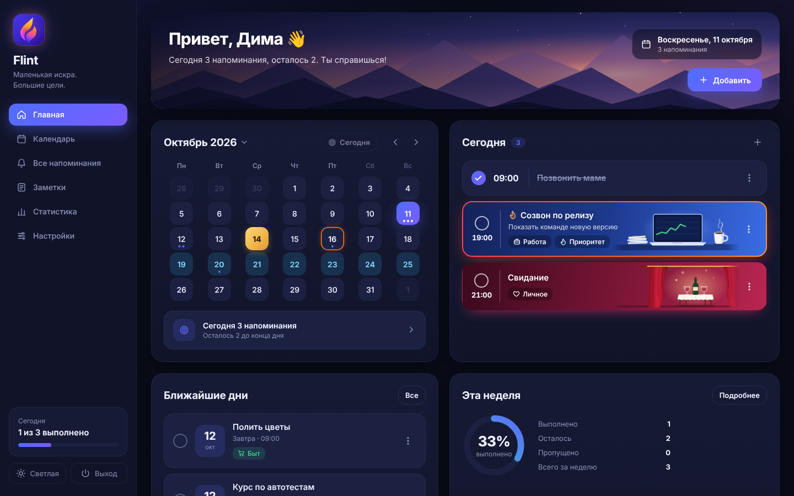
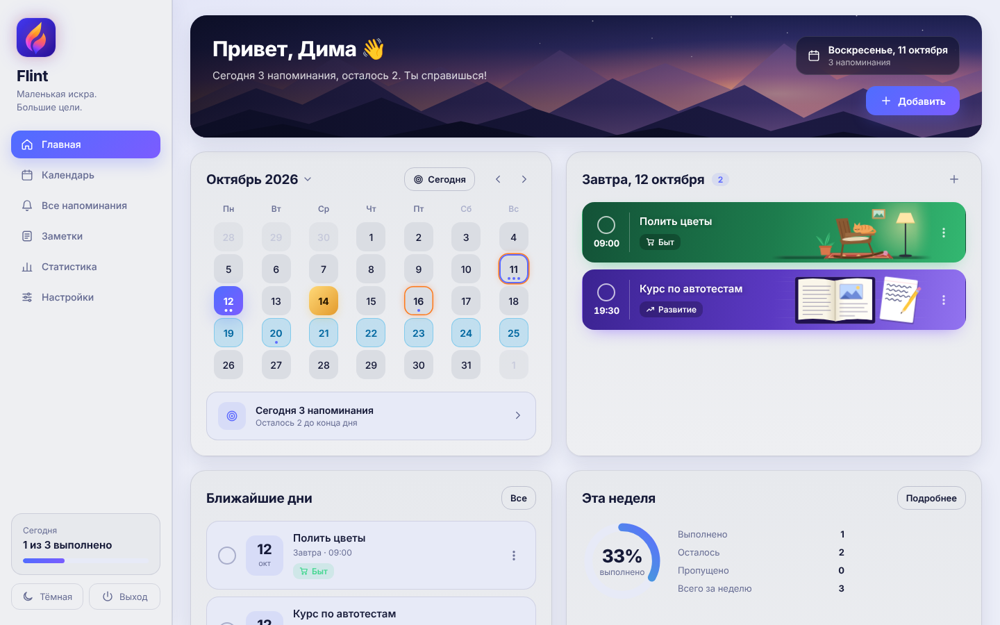
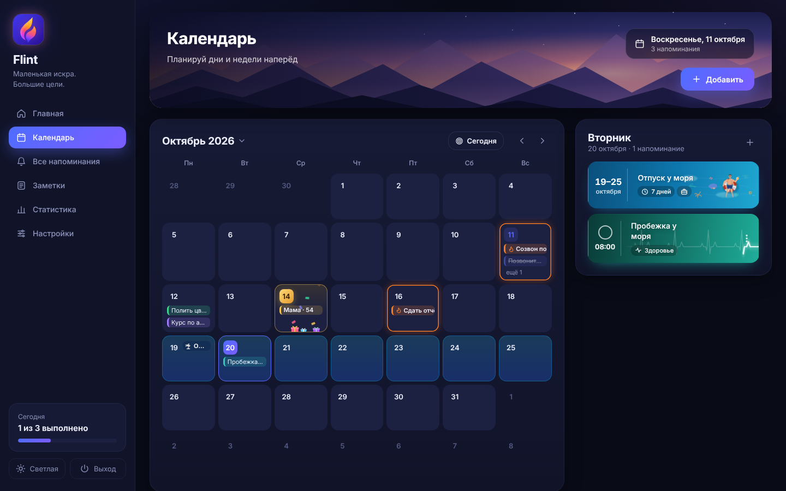
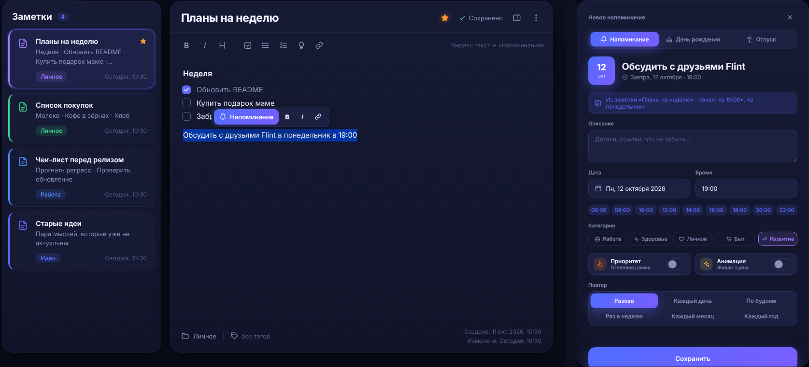

  

<h1 align="center">Flint</h1>

  <b>Маленькая искра. Большие цели.</b> 
  Напоминалка для Windows, которая напомнит о важном, поздравит с днём рождения и не потревожит в отпуске.

  <a href="https://github.com/k1nzar34/flint-releases/releases/latest"><b>⬇ Скачать Flint для Windows</b></a>

---

Открываешь Flint, и тебя встречает **Главная**. Слева месяц: каждая дата на своей мягкой плитке, день с важной задачей обведён огненной рамкой, день рождения светится золотом. Справа список дел на выбранный день, и у задачи может быть свой маленький живой баннер. У рабочего созвона на столе ноутбук с графиком и кружка, от которой поднимается пар. У свидания колышутся красные шторы и ждёт накрытый столик.

Анимации во Flint спокойные: ничего не мигает и не дёргает внимание, сцены просто тихо живут на фоне. Баннер включается отдельно для каждого напоминания — одним переключателем «Анимация» в окне задачи. А в настройках можно выбрать эффект подсветки (лава, без лавы или совсем без анимаций), скорость, и одним тумблером остановить все «живые картинки» — тогда сцены замрут красивым статичным кадром. Если в Windows выключены анимации, Flint это заметит и тоже будет показывать всё статично.

Днём бывает приятнее светлое — для этого есть **светлая тема** в спокойных серых тонах. Здесь, например, дома в кресле дремлет кот, а над раскрытой книгой карандаш сам пишет пару строк и тут же их стирает. Любой день можно выбрать прямо в календаре слева.

В **Календаре** месяц виден целиком. Отпуск разливается по дням морем, и в нём можно включить «не напоминать о работе» — тогда рабочие задачи в эти дни не побеспокоят. Дни рождения отмечены тортом и подарками, а Flint заранее предупредит: в сам день, за день или за неделю — как удобнее. Если человек указал год рождения, Flint посчитает, сколько ему исполняется.

Особое место во Flint занимают **заметки**. Это не другая программа, а раздел прямо внутри: заголовки, списки, чек-листы, папки, теги, избранное и поиск по тексту. Всё сохраняется само, а для быстрого старта есть шаблоны — список дел, покупки, идея, дневник.

Главное — заметка и напоминание здесь связаны. Пишешь в заметке «обсудить с друзьями Flint в понедельник в 19:00», выделяешь фразу и нажимаешь «Напоминание». Flint сам поймёт дату и время, уберёт их из названия и предложит готовое напоминание. Остаётся нажать «Сохранить» — и мысль уже стоит в календаре, а из заметки видно, какие напоминания к ней привязаны.

Удалить заметку случайно не получится: ползунок нужно дотянуть до конца, и только тогда заметка сгорит. Если к ней привязаны напоминания, Flint спросит, оставить их в календаре или сжечь вместе с заметкой.

Когда подходит время, в углу экрана появляется **аккуратное окно** поверх остальных: можно открыть задачу, сразу отметить её выполненной или отложить — от 5 минут до пары часов. Если напоминаний несколько, они не наваливаются кучей, а встают в очередь, не больше двух на экране.

Кроме того, во Flint есть статистика выполненного за неделю, месяц и год; обращение на «ты» в мужском, женском или нейтральном роде; запуск вместе с Windows. Крестик прячет Flint в трей — огонёк у часов, — и напоминания продолжают работать.

## Что важно знать

**Flint работает полностью офлайн.** Все записи и заметки хранятся только у тебя на компьютере, в одном файле `%APPDATA%\Flint\data.json`, и никуда не отправляются. Чтобы сделать резервную копию или перенести всё на другой компьютер, достаточно скопировать этот файл.

**Обновляется сам.** Раз в сутки Flint тихо проверяет, не вышла ли новая версия, и предложит обновиться одной кнопкой. Проверить вручную можно в настройках.

## Как установить

1. Скачай `Flint.exe` со [страницы последнего релиза](https://github.com/k1nzar34/flint-releases/releases/latest). Устанавливать ничего не нужно — это один файл, его можно положить в любую папку.
2. Запусти. Windows может показать окно «Система Windows защитила ваш компьютер» — так бывает с программами без платной цифровой подписи. Нажми «Подробнее» → «Выполнить в любом случае».
3. Для работы нужен WebView2 — на Windows 10 и 11 он почти всегда уже есть.

Ошибки и предложения — в [Issues](https://github.com/k1nzar34/flint-releases/issues).
